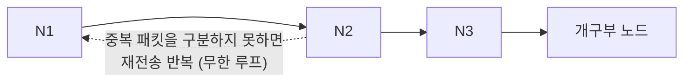

# 1바이트 패킷 · 개구부 노드 일관 전송

LoRa Mesh 환경에서 작업자 노드의 정보를 개구부 노드로 일관되게 전달하기 위한 통신 구조 구상안입니다.

## 목차

- [1. 집약 노드 선정 기준](#1-집약-노드-선정-기준)
- [2. 중복 패킷 처리](#2-중복-패킷-처리)
- [3. 패킷 구조](#3-패킷-구조)
  - [3.1 패킷 헤더 구성](#31-패킷-헤더-구성)
  - [3.2 상태 패킷에 들어가야 할 내용](#32-상태-패킷에-들어가야-할-내용)
- [4. 패킷 충돌 문제 해결](#4-패킷-충돌-문제-해결)
  - [4.1 Random Backoff](#41-random-backoff)
  - [4.2 ACK + 재전송](#42-ack--재전송)
  - [4.3 우선순위 기반 전송](#43-우선순위-기반-전송)

---

## 1. 집약 노드 선정 기준

우리가 구상한 대로 개구부에 위치한 노드로 정보를 전달한다고 할 때, 물리적으로 가장 가까이 위치한 사람에게 전달하는 것이 용이할 수 있다. 그러나 철판과 같은 물체가 있으면 통신에 방해가 되어 다른 노드들보다 통신에 덜 유리할 수 있다.

따라서 **정보를 모으는 노드는 통신 품질이 가장 좋은 노드로 설정**하는 것이 좋다.

또한 데이터를 하나로 모으는 노드를 선택하는 과정의 기준도 중요하다. 따라서 각 노드가 주기적으로 주변 노드의 상태를 확인할 수 있는 구조로 한다. 참고할 지표는 다음과 같다.

- **RSSI** (수신 신호 세기)
- **SNR** (신호가 잡음에 비해 얼마나 뚜렷한지를 나타내는 지표)
- **Packet Loss**
- **Hop Count**
- **배터리 상태**

위와 같은 정보들을 참고하여 가장 최적의 노드를 이용하는 구조로 구성한다.

---

## 2. 중복 패킷 처리

N1 - N2 - N3 - 개구부 노드 순으로 노드들이 통신한다고 할 때를 가정한다.

A가 패킷을 B에게 전송하고 B가 C에게 전송하는 과정에서, A가 전송한 뒤 패킷이 B 노드, C 노드로 향했을 때 중복되는 패킷을 구분하지 못한다면 **무한 루프에 빠질 가능성**이 있다.

따라서 노드 간 통신이 원활히 이루어질 때 중복되는 정보를 구분할 수 있도록 해야 한다.

---

## 3. 패킷 구조

### 3.1 패킷 헤더 구성

| 순서 | 필드 | 설명 |
|:---:|---|---|
| 1 | Packet ID | 패킷 고유번호 |
| 2 | Source ID | 최초 발생 노드 |
| 3 | Destination | 개구부 / Gateway |
| 4 | Hop Count | 몇 번 중계됐는지 |
| 5 | Sequence No. | 데이터 순서 |
| 6 | Data Type | 생체 / 상태 / 경보 |
| 7 | Payload | 실제 데이터 |

### 3.2 상태 패킷에 들어가야 할 내용

- Node ID
- Packet ID
- Sequence
- 상태 정보
- Priority
- Hop Count
- Timestamp (데이터가 언제 발생했는지 기록해 놓는 시간 정보)

---

## 4. 패킷 충돌 문제 해결

LoRa Mesh를 사용하는 중에 사람 4명이 동시에 데이터를 보낸다면 서로 간의 전파가 겹칠 수 있다. 이에 대한 해결 방법은 다음과 같다.

### 4.1 Random Backoff

전송하는 시간을 랜덤으로 다르게 설정하여 서로 간 충돌할 확률을 낮춘다.

### 4.2 ACK + 재전송

상대 노드가 잘 받았는지 확인응답(ACK)으로 확인한다. 서로 간 전파가 겹치게 되면 ACK를 받지 못하게 되고, 이를 통해 통신이 원활하게 이루어지지 않았음을 알 수 있다.

### 4.3 우선순위 기반 전송

> 세 가지 방법 중 가장 적합해 보이는 방법

우리가 만든 데이터에서 일반 데이터와 긴급 데이터의 중요도를 서로 다르게 설정한 후, 아래와 같이 Backoff를 다르게 적용하여 긴급 패킷이 일반 패킷보다 우선적으로 전송되도록 한다.

| 구분 | Backoff | 전송 |
|---|---|---|
| 긴급 패킷 | 짧은 Backoff | 빠른 전송 |
| 일반 패킷 | 긴 Backoff | 여유 있게 전송 |
----------------------------------------------------------------------------------------------

[캡디 10월 12일 현재진행상황.docx](https://github.com/user-attachments/files/33325817/10.12.docx)

